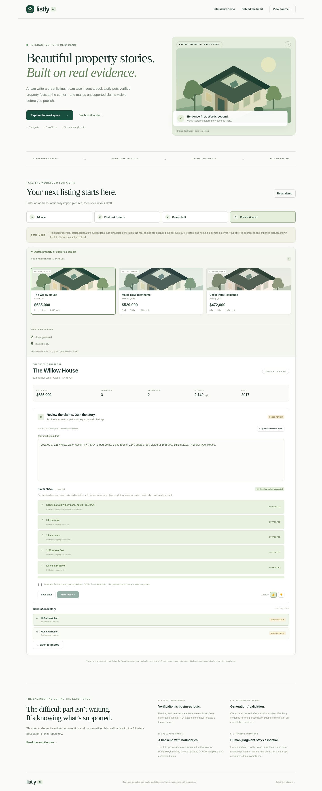
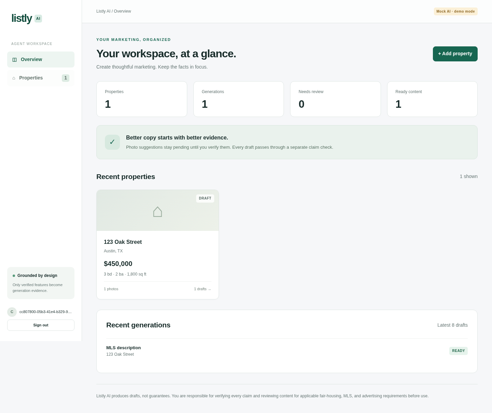
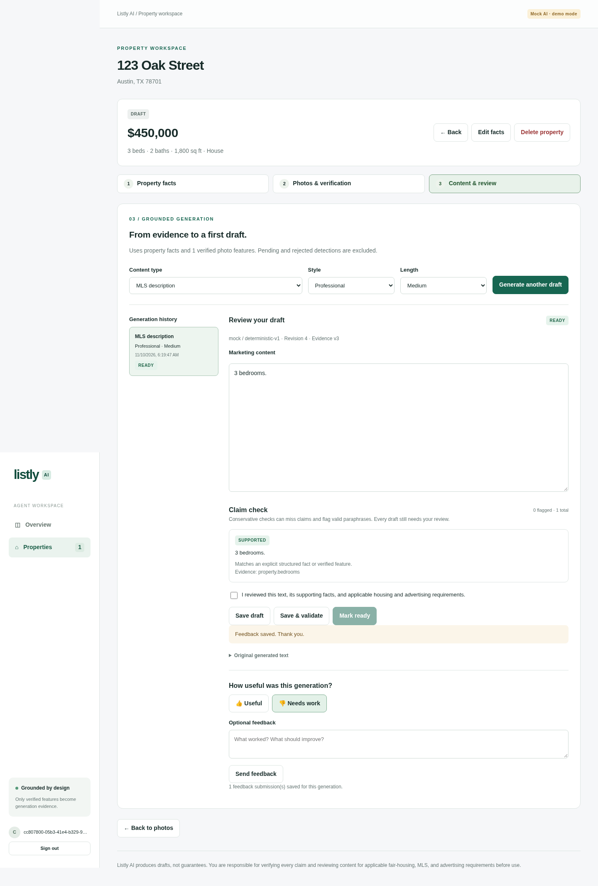
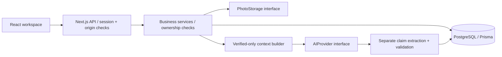

# Listly AI

AI-assisted real-estate marketing platform that grounds generated content in structured property data and verified visual features while detecting unsupported AI-generated property claims.

## Free interactive portfolio website

The repository includes a standalone, responsive demo for GitHub Pages, with fictional sample properties and no login or API key. Visitors can start with a single address, optionally import multiple pictures, verify/reject visible features, inspect generation context, generate deterministic drafts, edit claims, mark reviewed content ready, and explore session history. Unknown addresses do not receive invented property facts.

**After Pages is enabled and deployment succeeds:** [Open the portfolio demo](https://anishmanthena123.github.io/Real-Estate-Listing-Maker/).

To activate free hosting, choose **Settings → Pages → Source → GitHub Actions** in this repository, then run **Actions → Deploy portfolio demo → Run workflow**. See [Portfolio demo setup](docs/PORTFOLIO_DEMO.md). This is separate from the optional paid Render deployment of the full backend.

The demo reuses the full application's context builder and claim validator. It does not claim to run live AI, analyze actual photos, authenticate users, or persist their data. Its illustrations and property records are fictional; counters reflect only interactions in the current tab. The full Next.js/PostgreSQL application remains in this repository.

```bash
npm ci
npm run demo:build
npm run demo:preview
# Optional: test the standalone demo in desktop/mobile Chromium
npm run demo:test
```



## Live AI and property lookup

The hosted full app supports OpenAI-compatible photo analysis and an authenticated ATTOM public-record lookup. See [Live API setup](docs/LIVE_APIS.md). Both keys stay server-side. GitHub Pages remains a key-free static demo and cannot run these integrations.

The guided workflow is address → photos/verification → content/review. You can save an address without inventing a price, bedroom count, or dimensions. Real lookup suggestions require review, and missing facts remain null. Assessed/sale values are never substituted for a listing price.

## Problem

A fluent property description can invent a renovation, overstate a material, or assert that a neighborhood is safe. A model seeing an island in a photo does not establish that the kitchen was renovated. Marketing teams need traceable evidence and an explicit review process, not just a better prompt.

## Solution

Listly separates observation, verification, generation, claim checks, and human approval. Property facts belong to an authenticated agent. Photo suggestions begin `PENDING`; only agent-confirmed `VERIFIED` features can cross the server's generation boundary. Every generated draft saves its original text, original evidence, provider metadata, and extracted claim results. Edited text is revalidated. Changing facts or verification decisions makes existing content require review again.

The application supports property CRUD, private multi-photo uploads, photo analysis, six content types, style/length selection, an editable review workspace, generation history, revision-aware feedback, and a dashboard based on actual database counts.

## Deploy the full backend (optional)

Deploy this same repository as a full-stack app using the [Render setup guide](docs/RENDER_SETUP.md). The included blueprint provisions PostgreSQL and persistent photos and enables live AI after you enter a server-side API key. Hosting and API usage have separate costs; review pricing before provisioning.

## Full-app local demo

The authenticated backend has not been publicly deployed, and no customer usage is claimed. For the separate free portfolio website, use the GitHub Pages instructions above. To run the complete app locally, follow the setup below and create an account. `MOCK_AI=true` makes the complete workflow usable without a paid API or API key. Mock photo analysis returns fixed sample suggestions and **does not inspect the photo**. Its conservative, template-based copy intentionally tests the workflow rather than simulating natural writing quality or style fidelity.

Try this flow:

1. Add a property and upload a JPEG, PNG, or WebP.
2. Analyze the photo. Verify one suggestion and reject another.
3. Generate a draft; confirm that rejected and pending labels are absent.
4. Add “Features pool. Safe neighborhood.” to the editor and save to validate.
5. Inspect the flagged claims and remove their sentences. Save again.
6. Explicitly acknowledge your review and mark the supported content `READY`.
7. Change the property price and see that the content returns to `NEEDS_REVIEW`.

## Screenshots

These screenshots come from automated desktop/mobile browser tests using synthetic test properties and a mock provider. They do not represent real customers, verified property photos, or production usage.




[Mobile workspace](docs/screenshots/mobile.png)

## Architecture

Next.js App Router + React + strict TypeScript; PostgreSQL + Prisma's JavaScript PostgreSQL driver adapter; Zod validation; private filesystem storage behind an interface; replaceable mock and OpenAI-compatible AI providers; Vitest and Playwright.



See [Architecture](docs/ARCHITECTURE.md), [AI safety](docs/AI_SAFETY.md), and [Engineering decisions](docs/ENGINEERING_DECISIONS.md).

## AI Grounding Pipeline

```text
Property Data
      ↓
Photo Analysis
      ↓
Agent Verification
      ↓
Grounded Generation
      ↓
Claim Extraction
      ↓
Claim Validation
      ↓
Human Review
      ↓
Final Content
```

`buildContext` explicitly projects structured fields and filters features by `VERIFIED` plus a supported label catalog. Private notes, ownership data, photo paths, pending features, and rejected features are excluded. The provider never receives the raw property record. This is enforced in business logic and tested at the actual provider-call boundary, not just by hiding controls in the UI.

## Claim Validation

The validator extracts sentences and conservative atomic clauses. Exact normalized matches to explicit structured facts or verified feature statements are `SUPPORTED`. Unrecognized or unsupported assertions are `UNVERIFIED`; a limited marketing-safety pattern set flags `POTENTIALLY_MISLEADING` language. Each result stores its sentence, explanation, and evidence pointer.

It does **not** provide semantic entailment, exhaustive claim extraction, an accuracy score, or legal assurance. Valid paraphrases can be flagged; unfamiliar discriminatory wording can be missed. Text must be reviewed by an agent. A feature appearing inside an embellished sentence does not support the other words in that sentence.

A user can edit/remove a claim, substantiate it by correcting structured data or verifying an appropriate photo feature, or generate another draft. There is no browser-accessible “mark supported” bypass. `READY` requires a nonempty validated draft with no flagged claims and explicit review acknowledgement. Saving a draft permits unresolved claims; it does not make them supported.

## Technical Decisions

- Server-side opaque sessions, hashed bearer tokens, salted scrypt passwords, origin checks, and property ownership predicates.
- PostgreSQL transactions and per-property row locks serialize evidence updates and review writes. An evidence version prevents a slow AI response from saving against changed facts.
- Optimistic generation revisions reject stale editor saves.
- Original generation text/evidence remain separate from editable text/current validation evidence.
- A narrow feature catalog limits arbitrary prompt instructions and avoids unsupported material/renovation inference.
- AI requests have timeouts, bounded output, response validation, no redirects, and safe client-facing errors.
- Private photo endpoints authorize every read. Image decoding and re-encoding strip location metadata and validate real formats.
- A small SQL migration fallback supports restricted environments without disabling artifact integrity checks. Standard Prisma Migrate remains available for deployments with native-engine access.

## Security

Never trust browser `userId`. The API derives identity from an unexpired database session and the services enforce ownership for properties and all nested resources. Inaccessible valid IDs return the same 404 as missing resources. Malformed IDs fail validation before PostgreSQL casts. SQL values are parameterized.

Session cookies are HttpOnly, SameSite=Lax, and Secure on HTTPS origins; mutation endpoints require an exact configured Origin and reject cross-site fetch metadata. Database-backed request limits cover authentication and costly per-user operations. Client responses redact storage keys and password hashes; server-only import guards prevent accidental client imports of database/configuration modules. Secrets are never sent to React or returned by a configuration endpoint.

Production still needs operational hardening: TLS, trusted ingress body limits, email verification/password recovery/MFA or a managed identity provider, abuse monitoring, least-privilege database roles, backups, log retention, storage reconciliation, and a privacy/retention policy. The initial CSP permits inline framework scripts/styles; deploy a nonce-based CSP if your hosting setup supports it. No external security/compliance audit has been performed. The dependency audit found zero production advisories after patching Prisma tooling. Moderate minimatch advisories remain in development lint tooling; do not expose development/test tooling as a public service. See docs/VALIDATION.md.

## Testing

```bash
npm run lint
npm run typecheck
npm test                       # Node-only unit tests; no database required
npm run test:integration        # Real PostgreSQL, dedicated *_test database
npm run test:all                # Unit + database-backed service/API tests
npm run build
npx playwright install chromium # Once, unless using an existing Chromium
npm run test:e2e                # Built production app, desktop + mobile
```

Set `TEST_DATABASE_URL` to a disposable PostgreSQL database with a name ending in `_test`, apply the migrations there, and do not point tests at production:

```bash
docker compose exec db createdb -U listly listly_test
npm run db:test:migrate
```

The test migration helper and test runners load `.env` automatically. The helper validates the dedicated test database name before supplying its URL to the migration process. Unit/integration tests execute real ownership paths, forged identity attempts, uploads, provider failures, evidence filtering, claim classifications, stale evidence/revisions, review gates, and cascades. Browser tests run registration through logout on a production build and check mobile overflow. They remove their own fixtures; failed browser runs can leave orphaned files under the test storage directory. No coverage percentage or model accuracy claim is made.

In this managed environment, Chromium is installed at `/usr/bin/chromium`: use `PLAYWRIGHT_CHROMIUM_EXECUTABLE_PATH=/usr/bin/chromium npm run test:e2e`. Elsewhere use Playwright's installed browser.

## Setup

Prerequisites: Node.js 22.12+ (validated here with Node 24), npm, PostgreSQL 17 (Docker Compose is provided). Use the existing isolated checkout; a worktree is unnecessary.

```bash
cp .env.example .env            # Only if .env does not already exist
npm ci

docker compose up -d db
npm run db:migrate:sql
npm run dev
```

The example database password is for a loopback-only local Docker database. Use a unique secret and managed connection string in production. No real AI credential is required for the default mock workflow. Automatic lookup is disabled by default; enabling it requires ATTOM access separately.

`npm ci` generates the engine-free Prisma client. Native `npm run db:migrate` / `npm run db:dev` require access to `binaries.prisma.sh` for verified Prisma tooling downloads. This environment initially blocked that host. `db:migrate:sql` applies the committed SQL under a PostgreSQL advisory lock with checksums, transactions, and Prisma-compatible migration records. It is tested for repeat application. It refuses changed or unfinished migration history. It is **not** a schema-diff generator or general replacement for Prisma Migrate's repair/shadow-database tooling. See the decisions document before modifying migrations.

To make a production build locally:

```bash
npm run build
# Local smoke testing only; production must use an HTTPS APP_ORIGIN.
ALLOW_LOCAL_HTTP=true npm start
```

## Environment Variables

| Name                                  | Purpose                                                   | Required/default                                            |
| ------------------------------------- | --------------------------------------------------------- | ----------------------------------------------------------- |
| `DATABASE_URL`                        | Server PostgreSQL connection string                       | Required; protect credentials                               |
| `APP_ORIGIN`                          | Exact public origin, used for CSRF and cookie security    | Required; HTTPS in production                               |
| `MOCK_AI`                             | Select deterministic provider                             | `true`                                                      |
| `AI_BASE_URL`                         | OpenAI-compatible chat-completions base URL               | `https://api.openai.com/v1`; live mode requires HTTPS       |
| `AI_MODEL`                            | Provider model supporting text and vision                 | `gpt-4o-mini`                                               |
| `PROPERTY_LOOKUP_PROVIDER`            | Enable real public-record lookup                          | `disabled` or `attom`                                       |
| `ATTOM_API_KEY`                       | Private ATTOM Property API credential                     | Required when lookup is enabled                             |
| `AI_API_KEY`                          | Server-only AI credential                                 | Required only when `MOCK_AI=false`                          |
| `STORAGE_DIR`                         | Private persistent photo directory, outside public assets | `.data/photos`                                              |
| `TEST_DATABASE_URL`                   | Isolated disposable integration/browser database          | Required for those tests; ends in `_test`                   |
| `PLAYWRIGHT_CHROMIUM_EXECUTABLE_PATH` | Optional system browser executable                        | Unset uses Playwright Chromium                              |
| `ALLOW_LOCAL_HTTP`                    | Explicit production-server localhost smoke-test override  | Never set in public production                              |
| `PRISMA_JS_MIGRATIONS`                | Optional experimental JS schema-engine configuration      | Used only by client generation here; not needed for runtime |

Never use `NEXT_PUBLIC_` for AI keys or database credentials. Real provider testing is optional and may incur cost; no live-key run was performed. Configuring a provider does not prove it supports image inputs or JSON response format. Verify the selected endpoint/model before enabling real analysis.

## Project Structure

```text
src/app/                    Pages, layout, styles and thin API routes
src/components/             Authentication, property, photo and review interfaces
src/server/auth.ts          Passwords, sessions, CSRF and rate limiting
src/server/validation.ts    Boundary schemas and safe ID handling
src/server/service.ts       Owner-scoped workflow and transaction orchestration
src/server/ai/              Context builder, providers and claim validation
src/server/storage/         Private storage contract and image validation
prisma/                     Models and committed SQL migrations
scripts/                    Checksummed SQL migration fallback
tests/                     Unit, integration and browser tests
docs/                      Design, safety, decisions and screenshots
```

## Known Limitations

- Conservative English-language exact matching flags many legitimate paraphrases and can miss nuanced safety concerns. It cannot verify the truth of agent-entered facts or dishonest agent verification.
- The fixed feature catalog is intentionally small. Arbitrary evidence attachments and custom verified assertions are not implemented.
- Mock photo suggestions are illustrative; mock content does not reproduce live provider style/format quality. No live model accuracy has been measured.
- UI lists currently show the latest 200 properties and latest 100 generations per property. Full pagination/search and large-portfolio performance work remain.
- Local storage requires a persistent private volume; it is unsuitable for ephemeral/serverless deployment without a replacement storage adapter. File deletion failures log an operator action; they can leave private orphaned files.
- AI work runs synchronously with timeouts. Durable jobs, retry idempotency, provider spending limits, and richer observability remain future work.
- Authentication has no email verification, recovery, MFA, or admin interface. An account is not proof of agent licensing.
- Only current edits and the original generated text are retained; there is no complete edit-by-edit audit log. Feedback stores the reviewed revision number.
- `READY` is an application review state, never a legal or factual certification. Content is not automatically published anywhere.

## Future Work

Managed identity, object storage, full pagination, durable analysis/generation jobs, stronger abuse controls, an evidence/reviewer audit trail, independently evaluated semantic claim extraction, jurisdiction/MLS-specific review checklists, and accessibility testing with assistive technology. Add these in response to demonstrated needs rather than claiming them as completed.

## Deployment

See [Deployment checklist](docs/DEPLOYMENT.md). The application has been validated locally; no public deployment or environment publication has been performed.

## Portfolio preparation

[Interview preparation](docs/INTERVIEW_PREPARATION.md) identifies five technical questions and the code you should understand deeply. Explain the limitations and test evidence as candidly as the implementation. This repository began empty; the initial audit is recorded in [Implementation plan](docs/IMPLEMENTATION_PLAN.md).
